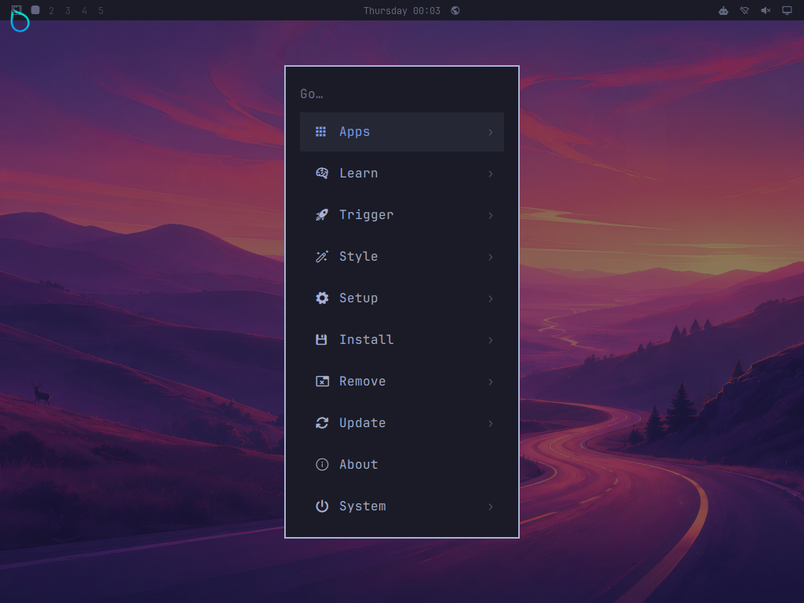
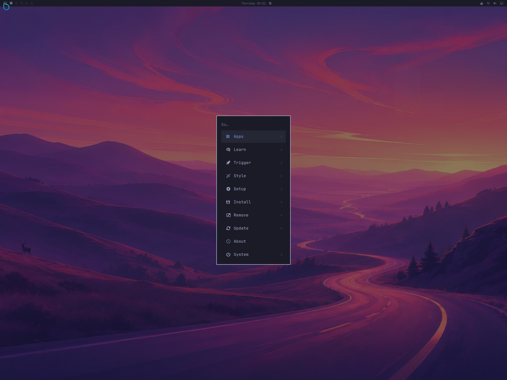

# Staged RAM integration and launcher hardening

Work began on 13 October and continued on 14 October 2026 (UTC).

This work proves a diskless ARM64 emulator path with actual display/input.
The launcher still selects the original minimal J96 Linux bundle. No iPad
has been attached or booted, and no desktop J96 image has been assembled.

## Complete focused and independent clean results

Both [focused run 38494636362](https://github.com/tcballard/iOMARCHY/actions/runs/38494636362)
and [clean run 38494636359](https://github.com/tcballard/iOMARCHY/actions/runs/38494636359)
passed at runtime commit `619fefa4fc056dfe82d281f3436db941f3e26244`, using
merge checkout `63b970d7fbf95c03c63ee3ab71f389c0954ab70c`.
The focused run built fresh userspace from 370 signed, verified cached
packages and retained the earlier QEMU kernel. The independent workflow
rebuilt the kernel and repeated the userspace, SquashFS and bootstrap builds.
Its four jobs—Ubuntu launcher, Arch launcher, firstboot and userspace—all passed.

Every desktop case passed the verified stream, read-only lower/writable RAM
overlay, core commands, exact icon font, unprivileged file-watcher event and
wallpaper-header checks. Each then displayed a real red terminal, received
virtual `x` and turned green. The upstream Omarchy bar and wallpaper rendered;
one pointer click invoked the actual menu command exactly once with exit 0,
the visible menu appeared, and Escape dismissed it. Each guest session exited 0.

| Run | RAM | Display | Interaction | Minimum sampled `MemAvailable` | Menu render wait |
|---|---:|---|---|---:|---:|
| Focused | 2048 MiB | 1024×768 | Pass | 603,228 KiB | 19,896 ms |
| Focused | 1536 MiB | 1024×768 | Pass | 90,800 KiB | 19,344 ms |
| Focused | 2048 MiB | 2048×1536 | Pass | 503,564 KiB | 28,896 ms |
| Clean | 2048 MiB | 1024×768 | Pass | 613,556 KiB | 13,026 ms |
| Clean | 1536 MiB | 1024×768 | Pass | 99,432 KiB | 12,525 ms |
| Clean | 2048 MiB | 2048×1536 | Pass | 491,820 KiB | 13,350 ms |

Both workflows also passed corrupt and truncated stream rejection before
root mounting: five RAM cases in each. All block-device queries returned
zero devices. There is no emulated disk, NIC, USB passthrough or swap in
these cases. The separate ordinary disk-based core boot also passed in the
clean workflow. All six menu captures were visually inspected: the actual
menu card, labels, icons, bar and wallpaper are present.

Both display modes use compositor scale 1. Menu render waits begin after
the real command result and layer readiness, not at the initial click.
The two button edges are queued in one QMP batch; guest observations of both
edges remain mandatory. The emulator shell uses the supported 30-second IPC
override after an observed two-second first-use timeout. Native defaults and
upstream sources remain unchanged. The full build enables and checks
`CONFIG_SQUASHFS_XATTR=y`; the focused run retains the older kernel without it.

The [focused evidence](ram-focused-evidence.json) and
[independent clean evidence](ram-clean-evidence.json) retain all five
invocations/results each, block-device queries, guest markers, command counts,
memory minima, host timing measurements, capture hashes and pixel counts.
The displayed PNGs are lossless conversions of the indicated raw menu captures;
their decoded RGB bytes were checked against the PPMs exactly.

The lowest 1536 MiB sample is about 88.7 MiB available. Samples are not
instantaneous memory peaks or a native hardware margin. Full resolution was
tested only at 2048 MiB. Apple firmware reservations, native drivers and A8
performance remain unmeasured. TCG timings do not predict A8 performance.
This is an experimental desktop subset, not full application or service
validation; see [userspace scope](../../arm64-rootfs.md).

Both workflows produced the same 899,698,688-byte SquashFS, SHA-256
`5122517375ab64273f765129f19ad3c50385b88fa31d20749f3ff904d5ad877f`,
and bootstrap SHA-256
`f3c33dc8d7b75fb7d10cdab078f0e5114d822b5bcf56df8e2280ed2456ceb78a`.
The clean workflow's two rootfs archives matched SHA-256
`fb704936dabf47fbe1084c7c8a7ac2882ef21f176f97be75c4250f0451ec522a`.
Archive comparison precedes installation of the isolated graphics candidate;
the SquashFS includes it. These results identify the tested inputs and do not
promise arbitrary future cross-host reproducibility.

The final follow-up commit adds these records/captures and removes the
temporary focused-retest workflow and its redundant path filter. It uses
`[skip ci]`; runtime code and locks remain those of the tested commit above.

## Build and launcher checks

[Run 38494636359](https://github.com/tcballard/iOMARCHY/actions/runs/38494636359)
tested the runtime commit and merge checkout above. Its Ubuntu and clean Arch
preparation jobs passed. Both ran the actual `start.sh --prepare` twice,
verified all eleven binaries and reused the cache. The full firstboot build,
repeat comparison and separate DRM probe passed; all eleven original
[baseline hashes](baseline-SHA256SUMS) were unchanged. The userspace job and
the workflow as a whole passed.

The Arch container digest was
`sha256:3c64b538588416593f69a1aebd2f2ec0f2541b29159f32556fa7def2167147a0`.
The [baseline artifact](https://github.com/tcballard/iOMARCHY/actions/runs/38494636359/artifacts/11863670608)
is 18,423,252 bytes, with GitHub-published ZIP SHA-256
`c6e82de488c0a1d2fa01383157d7470f83e2e6f818dcf8cb012915cc5b074f30`.
This ZIP digest is provider metadata; the eleven binary digests above were
independently compared with the retained baseline using the job log.

Launcher fixtures reject missing, duplicate, embedded, multiline, oversized,
overflowing and wrong-board identity fields. Corrupt downloads preserve
existing binaries; verified cache reuse works without downloading again.
Live DFU timing, identity reconnection and the XPS USB controller are untested.

Only the selected device's validated DFU/Pongo nodes enter palera1n's private
USB namespace. Recovery can be identified for manual DFU guidance but cannot
reach its recovery helper, which may set auto-boot. The launcher checks the
same physical port, model, chip, board and ECID across transitions, and a
random per-attempt Linux gadget serial before opening the terminal. Logs use
private permissions. Connection and normal-mode Trust waits are bounded.

A pinned libtiff URL really returned HTTP 404 during a clean build. The builder
recovered its exact bytes from the SHA-256-pinned input cache and then checked
the original package digest/signature. It never substituted a newer version.

## Integration failures caught

- The initial graphics cross-build double-prefixed protocol paths already
  rooted by pkg-config. Correcting the sysroot handling allowed compilation.
- QEMU initially supplied empty default floppy/SD slots. `-nodefaults` removes
  those; the zero-block-device assertion remains mandatory.
- SquashFS refused a loop device still opened writable. The bootstrap now
  holds a read-only descriptor until the mount retains its autoclearing loop.
- Aquamarine's GCC 13 build exposed private `std::format` symbols that bound
  to incompatible GCC 16 definitions in packaged Hyprland. An ARM64 crash
  backtrace identified the collision. A version script limits exports to the
  Aquamarine API, preserving the signed compositor and upstream sources.
- A live shell and working terminal initially produced a black shell capture.
  The probe now shares one private session bus, waits for the startup cover
  to clear and requires real bar/wallpaper pixels in scanout.
- The private Omarchy font was outside fontconfig's search path and no wallpaper
  was selected. Deterministic defaults register the untouched font and select
  Tokyo Night's `0-winding-road.webp` for root and the unprivileged probe user.
- `inotifywait --help` exits nonzero. Its replacement check observes a real
  file-created event from an unprivileged watcher. ImageMagick must read the
  selected wallpaper's 6016×3384 header before the display test.

[Run 38479860113](https://github.com/tcballard/iOMARCHY/actions/runs/38479860113)
passed terminal and uncovered-bar checks at both budgets before wallpaper/menu
checks existed. Minimum samples were 691,900 and 178,408 KiB respectively.
Those results must not be described as passing the later interaction contract.

[Run 38482291208](https://github.com/tcballard/iOMARCHY/actions/runs/38482291208)
passed the complete interaction at 2048 MiB, with a 613,752 KiB minimum sample.
At 1536 MiB the terminal, wallpaper and bar rendered, but the menu stayed
invisible during the 20-second capture window. Only 528 pixels changed,
mostly near the pointer. That lower-budget run failed.

The next probe streamed logs while processes ran, bounded control-socket
queries, added live memory/process samples and Escape cleanup, and increased
the first-menu-buffer allowance to 60 seconds. The pixel requirement stayed
unchanged. [Focused run 38484327989](https://github.com/tcballard/iOMARCHY/actions/runs/38484327989)
then passed both 1024×768 interactions, with minima of 633,632 and 88,428 KiB.
It predated full-resolution testing and the stronger command/edge checks.
Its timings alone do not establish why the earlier run exceeded 20 seconds.
An observed missing `pkill` also led to the procps-ng addition below.

## Independent clean-build input failure and correction

[Run 38484327993](https://github.com/tcballard/iOMARCHY/actions/runs/38484327993)
tested the same `31e18471bf866eb44f73a33b31994d0e1a8fcfaf` revision with a fresh
kernel and full foreign-loader cache setup. Both launcher jobs, all eleven
baseline hashes, the DRM probe, repeat rootfs/SquashFS/bootstrap checks, core
disk boot, 2048 MiB interaction and both invalid-transfer tests passed.
The 1536 MiB interaction **failed**, so this run is not a complete pass.

Its desktop remained alive, its clock advanced, and no OOM kill was recorded.
Minimum sampled available memory was 85,904 KiB. At the click, libinput reported
debounce timers already 505 and 407 ms late. The short press/release arrived
while that timer lagged; no menu layer appeared. The guest eventually returned
session result 8 and the host timed out waiting for a menu after the click.
At 2048 MiB, the menu needed 20,448 ms after layer detection, independently
showing why the original 20-second rendering allowance was too short under TCG.

The next revision replaces the host's fixed 100 ms mouse press with a guest
acknowledgement. Non-consuming Hyprland bindings observe button-down and
button-up while passing the same events to the actual shell. The host keeps
the button pressed until the guest reports processing it, then releases it
and requires the second acknowledgement. It still requires the real menu
layer, visible pixels and Escape dismissal. No IPC command opens the menu.
This tests delivered input instead of assuming that QMP acceptance means
the emulated compositor has already processed it.

[Clean-run failure evidence](https://github.com/tcballard/iOMARCHY/actions/runs/38484327993/artifacts/11860480217):
4,388,465 bytes, downloaded ZIP verified as
`9f58352735c82fd0fca6d28e58448432da533149ea6aad65c76b2c0410fa18ca`.
The full build/cache artifact is
[11859937920](https://github.com/tcballard/iOMARCHY/actions/runs/38484327993/artifacts/11859937920),
2,509,941,863 bytes; GitHub-published ZIP SHA-256
`722843591011c9276c2ba9cce90a6601f1214bdf4151ddcc71854a655e1d3a0f`.
That large ZIP digest is provider metadata, not a claim of a local download.

## Pointer focus readiness

[Run 38487601566](https://github.com/tcballard/iOMARCHY/actions/runs/38487601566)
tested the acknowledgement change at `8df35ce727b75b6510201eb0efc1eada49b7daf2`.
The 2048 MiB interaction and both invalid-transfer checks passed, but the
1536 MiB menu still failed to open. Both guest edge acknowledgements were
present, so the short press was not a complete explanation. Minimum sampled
available memory was 109,348 KiB, with no recorded OOM kill.

Comparing the logs found a more specific ordering difference. In the passing
run, the shell requested its pointing-hand cursor before the press. In the
failed run, that hover response arrived after the press. The pinned upstream
menu widget uses a MouseArea click and requests a pointing-hand cursor when
hovered. The test's remaining 300 ms host delay did not establish that this
guest focus transition had happened.

The next harness revision therefore requires a fresh pointing-hand request
after moving to the menu button, before pressing. Earlier cursor requests
cannot satisfy the check. It records the hover wait, retains both edge
acknowledgements, sends only one click and still requires the actual menu
layer, pixels and Escape dismissal. No shell IPC opens the menu.

The failed run's [evidence ZIP](https://github.com/tcballard/iOMARCHY/actions/runs/38487601566/artifacts/11859714660)
is 4,407,871 bytes, locally verified as
`5d2276d52517f1d6e5ca4c83313cc696f74493588ec03e8de33086d86daed24d`.

The hover-aware [run 38488850544](https://github.com/tcballard/iOMARCHY/actions/runs/38488850544)
passed at 2048 MiB, but still failed to open the menu at 1536 MiB despite
hover and both edge acknowledgements. The hover waits were 1,502 and 2,004 ms;
minimum available samples were 623,884 and 107,936 KiB. This demonstrates
that hover readiness alone was also insufficient, rather than proving the
entire failure was an input-timing problem.

The first full-pixel-count [run 38489241953](https://github.com/tcballard/iOMARCHY/actions/runs/38489241953)
tested `dab0568536cbb1f46343f7ba5282b203f9874095`. Its 1536 MiB/1024×768
interaction passed (117,892 KiB minimum), but both 2048 MiB cases failed
at menu opening. At 2048×1536, real terminal keyboard interaction, the bar and
wallpaper passed the pixel checks. Minimum sampled available memory was
465,120 KiB, approximately 454.2 MiB. That is full-size virtual rendering
evidence, not a complete interaction pass or a native iPad result.

The next diagnostic records the command launched by the real bar button,
including its exit status and error output. It neither opens the menu from
the probe nor changes upstream Omarchy source. This distinguishes a missing
button action from a failed command/IPC call.

[Run 38490342944](https://github.com/tcballard/iOMARCHY/actions/runs/38490342944)
made that distinction: the passing 2048 MiB case logged the real command and
exit status 0. The failing 1536 MiB case logged hover and both button edges,
but no command start. The failure happened before command execution; it is
not evidence that the shell's IPC deadline expired. Minimum available samples
were 605,724 and 98,952 KiB respectively.

The acknowledgement-before-release harness could keep the button held while
the guest probe and serial log reader each polled. The pinned
[bar](https://github.com/omacom/omarchy/blob/47caa9be439e1876b6048a32a868688e9c697d48/shell/plugins/bar/Bar.qml)
has a propagated press-and-hold gesture path; Qt's
[MouseArea](https://github.com/qt/qtdeclarative/blob/v6.12.0/src/quick/items/qquickmousearea.cpp)
suppresses `clicked` after a handled long press. This identified a flaw in the
test itself: an acknowledgement wait can turn the intended click into another
gesture. The trace did not directly log Qt's internal long-press flag.

The correction preserves hover readiness, sends a short press and release,
then verifies both guest edge acknowledgements. It also requires exit status
0 from the actual bar command before accepting the visible menu and Escape
dismissal. The diagnostic is scoped to the emulator shell's child Bash
command; upstream sources and the normal IPC timeout remain unchanged.

The first short-click [run 38491602155](https://github.com/tcballard/iOMARCHY/actions/runs/38491602155)
still failed at 2048 MiB: both compositor edge observations were present,
but the real bar command did not start. The host timed out waiting for its
result. Its immediate evidence ZIP (artifact `11861814054`, 2,485,654 bytes)
was locally verified as
`6ff8b853437d451bf25aa3bd766015d29f22dff581be39ad00836d562ac51036`.
Thus shortening the press did not establish a complete fix. A separate
diagnostic branch records Wayland pointer events and Qt delivery without
modifying upstream Omarchy source; its instrumented payload is not the
ordinary clean-build payload.

The same run's 1536 MiB case exposed a distinct failure: the command did
start, printed `omarchy-shell is not responding` and exited 1. The upstream
two-second IPC deadline had expired; this was not a missing click. Its full
evidence ZIP (artifact `11861599770`, 12,628,288 bytes) was locally verified as
`6eafe00cebdff885191524e7d02b92661aadd966c341c4d25686aeb927d87e17`.

[Run 38491953696](https://github.com/tcballard/iOMARCHY/actions/runs/38491953696)
at `c43beda1d2bcca9e38e85948d16aa963e0c8eeb2` passed both 1024×768 cases,
with exactly one command invocation and exit 0 in each. The 2048×1536 case
rendered the terminal, bar and wallpaper, but again logged no command start
after the click. Its smallest periodic available-memory sample was
490,604 KiB; the host ended the failed run before a final minimum marker.
Both invalid-transfer cases passed. This was not a complete workflow pass.
Its evidence ZIP (artifact `11863205249`, 11,435,149 bytes) was locally
verified as `2abe75f323bd6a0865e95556f4dd8d267f903e795a601c55d500ab023bc548b0`.

The independent [run 38491953690](https://github.com/tcballard/iOMARCHY/actions/runs/38491953690)
at the same revision passed repeat rootfs/SquashFS/bootstrap comparisons,
the ordinary disk boot, both 2048 MiB desktop cases and both invalid streams.
The full 2048×1536 menu was visually inspected: labels, icons, bar and
wallpaper were present, the actual command exited 0, and Escape dismissed it.
Its minimum available sample was 480,212 KiB; the smaller-display 2048 MiB
case reached 616,976 KiB. The 1536 MiB case failed with no command start,
despite both pointer edges and a 147,704 KiB minimum. This independently
reproduced the activation failure without an OOM kill.

The focused evidence ZIP (artifact `11863481139`, 10,632,965 bytes) was
locally verified as
`0b37ce529aa74f3739dd2a172ebac22e33c919ccf8a7652bcebe289d09f9cc91`.
The full build/cache artifact `11863201473` is 2,547,907,541 bytes, with
provider ZIP digest
`cf7dd880d3108da8636e44309fed2757b30ee8c40a4e03d9bc84854b0d50ff34`.
The large artifact has not been downloaded locally.

## Traced input latency

The isolated [input trace](https://github.com/tcballard/iOMARCHY/actions/runs/38493312724)
at `cb0659bd41c64e5cb3a8620e8baa2de2d855c574` recorded both Wayland events
and Qt delivery in its failed 2048 MiB case. The button's event timestamps
were 153,558 and 153,664 ms: a 106 ms press. The corresponding Wayland
dispatch trace times were `00:02:34.387405` and `00:02:35.620389`, separated
by 1,232.984 ms, with rendering between them. Qt received both events at
the intended coordinates, but the bar command did not start. This is
consistent with the held-gesture path; Qt's internal long-press flag was
not directly recorded. Tracing itself adds overhead.

All three traced desktop cases failed to start the menu command:

| RAM / display | Button timestamp interval | Wayland dispatch interval |
|---|---:|---:|
| 2048 MiB / 1024×768 | 106 ms | 1,232.984 ms |
| 1536 MiB / 1024×768 | 102 ms | 3,449.100 ms |
| 2048 MiB / 2048×1536 | 100 ms | 1,022.797 ms |

Both invalid-transfer cases passed. The complete trace ZIP (artifact
`11863172685`, 12,699,722 bytes) was locally verified as
`6000b9c6a0374d737f5ff9e6fc505a385ff0f1710e821041b7182cf88db3ec16`.

Its immediate evidence ZIP (artifact `11863372056`, 2,513,256 bytes) was
locally verified as
`f7d32eb32470295034c3fe3eaa878e5517b2d2e7b9b952c05a04e40f95244a32`.
The preceding trace attempt stopped on HTTP 429 while downloading the
pinned cpio generator; bounded download retries were then added.

The final runtime revision queues press and release together in one QMP input batch,
then still requires both compositor observations, exactly one real menu
command with exit 0, visible menu pixels and Escape dismissal. It separately
sets the supported `OMARCHY_SHELL_IPC_TIMEOUT=30s` only for the emulator
shell, addressing the observed exit-1 timeout. Upstream source and native
defaults remain intact. The focused and independent clean runs documented
at the top both passed all five cases with these changes. Neither is a native
input or performance claim.

## Signed runtime additions

All original 362 package rows remain byte-for-byte unchanged. Eight additions
use the existing pinned Arch Linux ARM keyring:

| Package | Version | Purpose |
|---|---|---|
| socat | 1.8.1.3-1 | Upstream shell IPC |
| inotify-tools | 4.26.270-1 | Plugin directory watcher |
| imagemagick | 7.1.2.33-3 | Wallpaper dimensions before decoding |
| liblqr | 0.4.3-1 | ImageMagick dependency |
| libraqm | 0.11.0-1 | ImageMagick dependency |
| libtool | 2.6.0+r23+gb08cb0a0-1 | Required libltdl |
| tar | 1.35-5 | libtool dependency |
| procps-ng | 4.0.7-1 | Shell process utilities and memory diagnostics |

Each archive matched its SHA-256 and passed `gpgv`. Authenticated `.PKGINFO`
dependencies are satisfied by this set and the original packages: Bash provides
`sh`, libtool provides `libltdl`, and procps-ng uses the already pinned glibc,
ncurses and systemd-libs. Additional extra/core database digests are
`49d747acaed276cef6a77c0a20ffcfd0e3f949384c6328f20537d7841896dce3`
and `91b52f917c664d5c6c16686b4749b2c4bb3f2673b49097f736d145ba88016364`.
The 370-package lock SHA-256 is
`236cc343fd73eb836dde03ed9e3105d7be1fc263c87ec41b1d51817a373c7d66`.
No upstream installer, Asahi detection or hardware provisioning runs.

## Retained artifacts

[Current focused evidence](https://github.com/tcballard/iOMARCHY/actions/runs/38494636362/artifacts/11863642251):
10,020,154 bytes; downloaded ZIP verified as SHA-256
`1066c8de1d1714e2d76b3d4db2ac85bbbcdfa90b37e9cd0b9aae7190b1ac6cc2`.

[Current clean evidence](https://github.com/tcballard/iOMARCHY/actions/runs/38494636359/artifacts/11864196068):
10,039,768 bytes; downloaded ZIP verified as SHA-256
`30c4284b341a793218fe9ee9540e944116fd55df103c6a347ef54da322c57b95`.

Each contains five passing invocations/results, actual PPM captures, pixel
counts, serial logs and bootstrap pins. Both online copies expire on
13 November 2026; the JSON records and selected PNGs are committed here.

[Current full build/input cache](https://github.com/tcballard/iOMARCHY/actions/runs/38494636359/artifacts/11864590760):
2,547,910,712 bytes; GitHub-published ZIP SHA-256
`7433bb7909216bff06a3ad9a8f3f4057565ba579dfe557d70860e0b1bc4e0fd6`.
This large ZIP was not downloaded locally. It expires on 13 November 2026.

The earlier [two-budget evidence](https://github.com/tcballard/iOMARCHY/actions/runs/38484327989/artifacts/11860170422)
is 3,790,929 bytes, downloaded ZIP SHA-256
`a8a9f203a953ee924ebf16f8f3d76ed9ff898981cabe4ab368d3106886f416aa`.
Its four passing cases predate the stronger current contract and full-resolution test.

The earlier [complete build/input cache](https://github.com/tcballard/iOMARCHY/actions/runs/38472217368/artifacts/11853616690)
is 2,466,292,506 bytes, ZIP SHA-256
`3334de437e59005ac625e69658524b02961d2129011a9ee2b9e3e41443557038`.
That run's initial RAM integration failed as described above; it supplied
verified cached downloads and the separate virtual kernel for focused reruns.
Retain exact artifacts/manifests before online retention expires. ZIP hashes
describe download containers, not individual payloads.

## Physical boundary

PongoOS limits one upload to 128 MiB; the roughly 858 MiB root filesystem cannot
be appended to that upload. The small bootstrap instead receives it after
boot through a dedicated virtual serial channel, hashes it before mounting,
and retains one compressed copy under read-only SquashFS plus bounded tmpfs.
See [the architecture and test contract](../../ram-boot.md).

Physical USB ACM payload transport, a desktop-capable J96 profile, native
scanout and useful physical input remain unimplemented or unverified. The
unchanged minimal Linux shell is the next hardware milestone. No internal
storage, Apple firmware, iPadOS restore or persistent device change was made.
